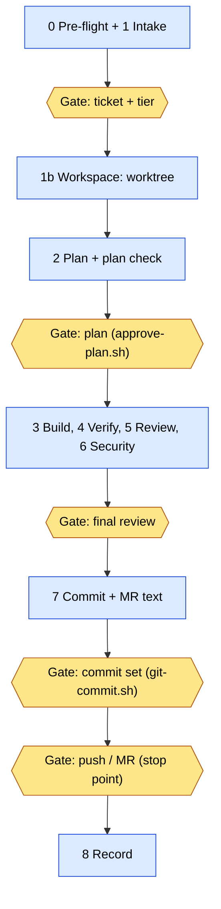
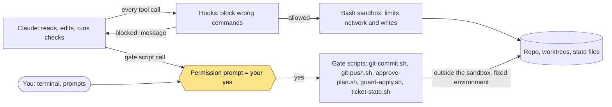

# deliver-ticket

Status: v0.2 (dev), used by one developer so far; not yet rolled out to a team.

Contents: [What it is](#what-it-is) · [Requirements](#requirements) · [Quick start](#quick-start) · [How a ticket flows](#how-a-ticket-flows) · [Safety model](#safety-model) · [Known limits](#known-limits) · [Reference](#reference) (install, emergency, settings, extending, rules, troubleshooting, tests)

## What it is

A Claude Code skill that takes one ticket from text to a reviewed commit. You type `/deliver-ticket`; Claude does the work between gates; you decide at the gates (`SKILL.md` section 4).

- Commands: `/deliver-ticket init`, `/deliver-ticket <ticket-id|file>`, `/deliver-ticket <ID> cancel`.
- Run it only by typing it. The skill never picks up tickets on its own (`SKILL.md` frontmatter: `disable-model-invocation: true`).
- Claude never merges. Merge in the GitLab UI.
- Design rationale: `docs/plan.md`. Safety detail: `docs/safety.md`.
- `<state root>` below means `$DELIVER_TICKET_HOME`, default `~/.local/share/deliver-ticket` (`SKILL.md` section 3).

**When not to use it:**

- Auto mode, plan mode or Code Mode sessions. They are not supported (see "Permission mode" below).
- Two projects in one session while a ticket is open. The session stays bound to the first project (`SKILL.md` section 3b).
- Any OS but macOS. Only macOS was probed (see the table below).
- A team whose own `pre-commit` / `pre-push` hooks must run on Claude's commits and pushes. They do not run (`docs/safety.md`, "Commits under the project sandbox").
- Merging from the command line. `glab mr merge` and `gh pr merge` are denied in every project.

## Requirements

| Need | Detail | Source |
|---|---|---|
| Claude Code | 2.1.311 or newer. Below it, stage 0 warns (and `scripts/install.sh` warns). | `stages/0-environment.md` check 1: "Below -> warn"; `scripts/install.sh` `MIN_CLAUDE` |
| macOS | Only macOS was probed. `install.sh` has no OS check. | table below |
| `git`, `python3`, `bash` | `install.sh` stops if one is missing. | `scripts/install.sh` |
| `glab` | Optional. Needed only for stop points that create a GitLab MR. | `scripts/install.sh` |
| python3 / git for the gate scripts | Taken from a fixed list, never from PATH: `/opt/homebrew/bin`, `/usr/local/bin`, `/usr/bin`. `install-hooks.sh status` prints the choice. | `scripts/fixed_env.py` `PY_CANDIDATES`, `GIT_CANDIDATES` |
| Permission mode | Default mode only (see below). | `SKILL.md` |

**Tested on / not tested** (what was actually run; "inference" = read from code, not run):

| Area | Tested | Not tested |
|---|---|---|
| OS and machine | macOS on Apple Silicon (a `darwin-arm64` binary appears in the probe logs); python3 from Homebrew, git from `/usr/bin` on that machine; one machine, one account | Linux (the sandbox `denyWrite` globs work on macOS only, `scripts/install_hooks.py:90`), Windows, Intel Mac, a Mac without Homebrew |
| Claude Code | 2.1.311 (full ticket dry runs, full probe pass); 2.1.325 (full probe pass, 179 runs, no FAIL; no full ticket run) | anything newer than 2.1.325 |
| Project stack | one Node monorepo: pnpm, Turbo, Next.js (16.x) | npm, yarn, bun; non-Node stacks (`profiles/` holds only `node.md`) |
| Tracker and MR | ticket given as pasted text or a file; GitLab through `glab` 1.124.0, the adapter checked against a local mock server (`adapters/gitlab-glab.md`) | GitHub (no adapter; `adapters/` holds `gitlab-glab.md` and `manual.md`); a real GitLab MR created by the skill (no record found: unverified) |

Init's risk globs are still specific to the tested project. A generic init is planned for v0.3 (`docs/plan.md`).

## Quick start

1. Install (once per machine). Clone to exactly `~/.claude/skills/deliver-ticket`, then run the installer. It shows the settings diff and writes only after your `y`.

   ```sh
   git clone <this repo's URL> ~/.claude/skills/deliver-ticket
   ~/.claude/skills/deliver-ticket/scripts/install.sh
   ```

2. Start Claude Code in your project's **main checkout**, in default mode, and set the project up (once per project). Init asks its questions and shows each settings diff before it writes.

   ```sh
   claude
   ```
   ```
   /deliver-ticket init
   ```

3. Run one ticket (paste the text, or give an ID or a file).

   ```
   /deliver-ticket <ticket-id|file>
   ```

4. At each gate read what Claude shows and answer. At the end, Claude records lessons and closes the ticket after your yes (`ticket-state.sh`). To abandon a ticket:

   ```
   /deliver-ticket <ID> cancel
   ```

Details: "Install on a new machine" below.

## How a ticket flows



Yellow hexagons are your decisions. Blue boxes are Claude's work. Tier B is drawn; tier C asks at every stage (table below). The table is the text version.

| # | Stage | File | Gate with you |
|---|---|---|---|
| 0 | Pre-flight (no changes) | `stages/0-environment.md` | auto unless a check fails |
| 1 | Intake: normalise, Definition of Ready, classify, questions | `stages/1-intake.md` | every tier |
| 1b | Workspace (worktree) | `stages/1b-workspace.md` | auto |
| 2 | Plan + plan check | `stages/2-plan.md` | B, C |
| 3 | Build | `stages/3-build.md` | C |
| 4 | Verify | `stages/4-verify.md` | by tier |
| 5 | Review | `stages/5-review.md` | B, C |
| 6 | Security | `stages/6-security.md` | C (B: findings at the final review) |
| 7 | Commit + MR text | `stages/7-commit-mr.md` | by tier |
| 8 | Record | `stages/8-record.md` | auto |
| - | Rework (MR comments) | `stages/rework.md` | by tier |
| - | Cancel | `stages/cancel.md` | you |

**Tiers** (`SKILL.md` section 4, `stages/1-intake.md`):

| Tier | What it means | Gates with you |
|---|---|---|
| A | Lowest risk. The skill runs it as B and the log says `classified A, run as B (v0.1)`. | as B |
| B | Normal ticket. | ticket + tier, plan, final review, the commit set at stage 7 (one yes covers all planned commits) |
| C | Risky ticket. | every stage; asks before every commit |

- Claude proposes the tier from the text and `classify.py`. Only you can lower it, with a reason. It can only rise afterwards.
- **Stop points**, lowest to highest: `local` -> `before-push` -> `draft-mr` -> `ready-mr`. The default per tier is in the project config.
- **Soft mode:** if you decline the hooks at init, or the hook self-test fails, the skill runs without hooks and permission rules. Stop point is capped at `local`, and it asks before every commit (`init.md` step 4, `stages/0-environment.md` check 5).

## Safety model

Three layers, none of them trusts the others:



- **Hooks** (`hooks/`) run before each Bash, Edit and Write call. They block wrong commands and say why.
- **Sandbox**: the project's Bash commands run with limited network and write paths. `install-hooks.sh project-sandbox-apply` turns it on per project.
- **Gate scripts** run outside the sandbox, but only after the permission prompt on their exact path. That prompt is your yes.

Gates you answer:

| Gate | Where | What you approve |
|---|---|---|
| Ticket + tier | stage 1 | the normalised ticket and the tier |
| Plan | stage 2 | the plan, identified by its hash (`plan-hash.sh`, then the prompt on `approve-plan.sh`) |
| Final review | stage 5 / 6 | review and security findings |
| Commit | stage 7 | each commit, through the prompt on `git-commit.sh` |
| Push / MR | stage 7, by stop point | the prompt on `git-push.sh`, `glab mr create` or `gh pr create` |
| Close | stage 8 | the prompt on `ticket-state.sh` |
| Project config | init | the prompt on `guard-apply.sh` |

Prompts you will see, and what they mean:

| Prompt | Meaning |
|---|---|
| `git-commit.sh`, `git-push.sh`, `approve-plan.sh`, `guard-apply.sh`, `ticket-state.sh` | A gate. Your yes is the approval. |
| `glab mr create`, `gh pr create` | A gate. Creates an MR / PR at the stop point. |
| `glab` / `gh` write forms (`api`, `mr update`, `pr edit`, ...) | An enumerated ask list at user level. Anything outward needs your yes. |
| `pnpm add` / `pnpm install` | Adds or changes dependencies. Plain spelling only (not the alias `pnpm i`, not via `npx` / `corepack`). |
| A network host you did not allow | The sandbox allows only the hosts you named at project setup. |
| Any other prompt | An extra prompt, not a gate. Note stage and command; `docs/sandbox-dry-run.md` counts these. |

What Claude cannot do (by hook, unless noted):

| Claude cannot | How |
|---|---|
| Change `~/.claude/settings*`, hooks or the skill dir | The hook blocks writes to `~/.claude/` by Bash and by Edit / Write, except `projects/*/memory` (`hooks/dtcore.py:1021-1026`). The `install-hooks.sh` writing subcommands run only in your own terminal. |
| Write the approval, the guard config, the session records or the delivery log | protected state; only the skill's own scripts write it |
| Write in the ticket's worktree before you approved the plan | the plan lock |
| Commit outside the gate | A plain `git commit` is blocked by the hook only in a ticket worktree (`hooks/dtcore.py:1674-1677`). Elsewhere in a repo with delivery state, `git commit` must be spelled the way its ask rule matches, so the prompt shows (`dtcore.py:1240`). With the project sandbox on, the sandbox denies the git ref store, so no Claude session in that repo commits outside the gate. Without the project sandbox only the prompt applies. |
| Push outside `git-push.sh` | Any `git push` is blocked in every Bash call in a repo with delivery state, bound session or not (`dtcore.py:1232`). In a repo without delivery state the hooks do nothing. `git-push.sh` pushes `HEAD` to the named branch of an allowed remote; the push hook also needs a verify record for the pushed tree. `check_push` (`dtcore.py:1117`) refuses force, delete, mirror, `--no-verify` and remotes outside the allowed list. |
| Push without a verify record for the pushed tree | the push hook reads `evidence/<ID>/verify.json` |
| Widen the sandbox per call | `allowed_domains` and `dangerouslyDisableSandbox` are blocked |
| Merge | `glab mr merge`, `gh pr merge` denied |
| Read `.env*` files | `Read(**/.env*)` denied; the hooks also block shell reads |

Detail and the exact limits of each protection: `docs/safety.md`.

### Permission mode

Launch in default mode. Do not use auto mode or plan mode.

```
claude
CLAUDE_CODE_DISABLE_AUTO_MEMORY=1 claude     # eval runs
```

- **Code Mode not supported (experimental).** If `CLAUDE_CODE_EXPERIMENTAL_CODE_MODE` is set to anything but empty or `0`, stage 0 stops. `install-hooks.sh apply` also registers a hook that denies Code Mode's `REPL` tool, in every session on this machine. Unset the variable, or set it to `0`.
- Ticket sessions run in default mode; **auto mode is not supported.** The probe `bash_allowed_domains_param` (Claude Code 2.1.311) showed a Bash call with the per-call `allowed_domains` parameter reaching a host outside the allowlist without a prompt. The hook blocks that parameter and `dangerouslyDisableSandbox`, nothing else; auto mode may approve other things. Do not pass `--permission-mode auto` or set `defaultMode: "auto"`. A skill cannot set the mode.
- The skill does not use plan mode: plan mode writes its plan under `~/.claude/plans/`, which the guard blocks (dry runs 2 and 3); its exit dialog switches the session to default mode; its "approved" is never your approval. Stage 2 writes the plan into the ticket file and stops at the gate.

## Known limits

- **`next/font/google` builds fail in the sandbox.** The sandbox blocks the macOS trust service that Next.js's font download needs for its TLS check (probed on 2.1.325), so `pnpm build` fails on the download. Stage 4 reports "known sandbox limit", never "build ok". It asks you to review the diff, then run the build yourself in your own terminal and paste the output. That output is recorded as user-run evidence (`stages/4-verify.md`, "Known sandbox limit"). A user-run paste never updates the push record, so you push yourself. Not offered: weakening the sandbox for the whole project.
- **Code Mode is not supported.** No rule or hook was probed under it.
- **`lock-trace.sh` is a trace, not proof.** The transcripts it reads are writable. It lists what the plan lock does not stop; an interpreter or a script file can still write a locked worktree.
- **Commits go only through the gate.** With the project sandbox on, no Claude session in that repo commits outside the gate, not even in the main checkout.
- **Claude's commits and pushes skip your repo's own git hooks.** Put what `pre-push` checks into `verify.on_push`.
- **A ticket whose worktree was made before this version**, or by Claude Code itself because the project `WorktreeCreate` hook is not registered, cannot commit through the gate.
- **Project-specific globs.** Init's risk globs fit the tested project only.
- **Unverified:** copying a project's state dir to another machine (the key comes from the checkout's absolute path); commit signing and an https push behind a proxy under the fixed environment of the gate scripts (`GPG_TTY`, `GNUPGHOME`, `HTTPS_PROXY` are not passed); a sandboxed plain push over SSH; whether `Read(**/.env*)` also stops the built-in Grep / Glob tools (`docs/phase5-checklist.md`); everything on versions after 2.1.325.

The full list of limits per protection is in `docs/safety.md`. Open decisions and the v0.3 backlog are in `docs/plan.md`.

## Reference

### Install on a new machine
Requirements: Claude Code (tested on **2.1.311** and probed on **2.1.325**; stage 0 warns below 2.1.311), `git`, `python3`, `bash`; `glab` is optional (only for stop points that create a GitLab MR).

1. Clone to **exactly** `~/.claude/skills/deliver-ticket` (the hooks and `SKILL.md` use that path): `git clone <this repo's URL> ~/.claude/skills/deliver-ticket` (the clone path matters, not where it comes from).
2. Run `~/.claude/skills/deliver-ticket/scripts/install.sh`. It checks the tools and the clone path, prints the `~/.claude/settings.json` diff, asks y/n, and only on `y` runs `install-hooks.sh apply --confirmed` (a backup is made) and `install-hooks.sh status`. By hand it is the same three steps: `scripts/install-hooks.sh diff`, then `apply --confirmed`, then `status`.
3. Per project, in its **main checkout**, start Claude Code (`claude`, default mode, see above) and run `/deliver-ticket init`. Init asks its questions and writes the project's state under the state root (`<state root>/<project-key>/`), not into this repo and not into the client repo; the per-project `WorktreeCreate` and `UserPromptSubmit` hooks go into `<repo>/.claude/settings.local.json` through `install-hooks.sh project-apply` (diff and your yes first).
4. The user-level rules that `apply` adds are global: **`glab mr merge` and `gh pr merge` are denied in every project** (merge in the GitLab UI), and pushes / MR creation ask first. See "Global permission rules" below.

Update: `git pull` in the clone, then `scripts/install-hooks.sh status`; it says if the registered hooks or rules differ from this version (then `diff`, your yes, `apply --confirmed`).

After the fast-forward, run `install-hooks.sh apply` from the live skill path (`~/.claude/skills/deliver-ticket/scripts/`), not from another clone: the Read rule it adds names the installer's own location (inference from `scripts/install_hooks.py:40, 109`, not run).

**Unverified:** whether copying a project's state dir (`<state root>/<project-key>/`) to another machine works. The key is derived from the main checkout's absolute path and `guard.json` holds absolute paths, so it should only work when the checkout sits at the same path (inference, not tested); otherwise run `/deliver-ticket init` again.

### Uninstall a project
Run `install-hooks.sh project-sandbox-off` before `project-uninstall` (both with `--repo <main checkout> --confirmed`). The other order leaves an empty `"allow": []` in `<repo>/.claude/settings.local.json` (harmless); `tests/run-installer.sh` pins both orders. The user-level `uninstall` is in the emergency section below.

### Emergency: a hook blocks every session

The hooks are registered in `~/.claude/settings.json` (user level). If a hook bug blocks all work, run these **from a normal terminal** (not from inside Claude Code):

```sh
# 1. see what is installed
~/.claude/skills/deliver-ticket/scripts/install-hooks.sh status

# 2a. remove exactly what `apply` added (hooks of this skill + the permission rules apply added; nothing else)
~/.claude/skills/deliver-ticket/scripts/install-hooks.sh uninstall            # dry run: prints the diff
~/.claude/skills/deliver-ticket/scripts/install-hooks.sh uninstall --confirmed # writes, with a backup

# 2b. or restore a backup (every apply/uninstall makes one next to the settings file)
ls -t ~/.claude/settings.json.bak-deliver-ticket-*
cp ~/.claude/settings.json.bak-deliver-ticket-<timestamp> ~/.claude/settings.json

# 2c. the per-project WorktreeCreate hook (lives in <repo>/.claude/settings.local.json, gitignored)
~/.claude/skills/deliver-ticket/scripts/install-hooks.sh project-uninstall --repo <main checkout> --confirmed   # backup goes to the project's state dir

# 2d. one session is stuck as "bound" (e.g. a ticket that cannot be closed properly): from a normal terminal, remove that session's map
#     <state root>/sessions/<session id>   (it only records which ticket the session works on)

# 3. last resort, no scripts: delete the entries whose "command" contains
#    /.claude/skills/deliver-ticket/hooks/ from ~/.claude/settings.json (and from <repo>/.claude/settings.local.json) by hand
```

The hooks do nothing in a repo without delivery state, except for the protected-state check described in `docs/safety.md`.

### Change settings

Re-run `/deliver-ticket init` in the project's main checkout and name the group(s) to change (re-run mode: it shows the current values, changes only the groups you name, regenerates `guard.json` and re-runs the hook checks). Editing `config.md` by hand also works; stage 0 then warns that `config.md` is newer than `guard.json`, and an init re-run regenerates it. Naming nothing = full refresh of `project.md`.

Groups and the default init proposes when it finds nothing better: Org policy / Decision-makers / Tracker / MR adapter: none (you answer; Delivery log off until answered; adapter `manual` if the glab check fails) · Project type, Verify, Git: detected from the repo and confirmed · Definition of Done: the template's list · Workspace: worktree per ticket, max 3 parallel in tier B/C and 5 in total, ports base 3100 step 10 · Verify timeout 300 s · Stage-0 checks: the 9 in `stages/0-environment.md` · Autonomy: tier B stop `before-push`, tier C `local` · Language `en`/`en` · Time tracking off. Changing the stage-0 checks means editing `stages/0-environment.md` (see Extending).

### Extending (add a file, don't edit the core)

| To add | Add | Touch |
|---|---|---|
| a tracker / MR adapter (GitHub, Jira, GitLab Issues, a messaging connector) | `adapters/<name>.md` implementing the four calls (check / create / update / comments) as in `adapters/manual.md` | the init MR group may list it (one line) |
| an ecosystem profile (Python, Go, ...) | `profiles/<name>.md` in the format of `profiles/node.md`: detect signals, where the commands are, watch globs, each row with its evidence or marked unverified | nothing else: init picks the profile whose detect signals match, and `scripts/project-map-stale.sh` reads the `dt:` lines of every profile (no script edit) |
| a stage or a check inside a stage | `stages/<N>-<name>.md`, or a numbered item in the existing stage file | one row in the table in `SKILL.md` section 4 |
| a template | `templates/<name>.md` | the stage that uses it |
| a hook that **replaces** a Claude Code default (e.g. `WorktreeCreate`) | register it per project (`PROJECT_SPECS` in `scripts/install_hooks.py`), never at user level; test it by comparing with behaviour **without** the hook (a test that only checks "a worktree was created" missed that `.worktreeinclude` stopped being copied) | `tests/run-installer.sh` |
| any hook change | add a test with a session that has **no open ticket** next to the ticket-session case (the first guard version blocked every session in an initialised repo and was only tested inside a ticket) | `tests/run-hooks.sh` |
| a hook rule (new block) | a branch in `hooks/dtcore.py` (`check_cmd`, `check_search`, ...) | **and** its tests in `tests/run-hooks.sh`: cases that must block and cases that must pass |
| a script | `scripts/<name>` | a test in `tests/` |

After **any** change: run `tests/run-guard-json.sh`, `tests/run-hooks.sh <new dir>`, `tests/run-worktree-create.sh <new dir>`, `tests/run-installer.sh <new dir>`, `tests/run-project-map.sh <new dir>`, `tests/run-compare.sh <new dir>`, `tests/run-base-worktree.sh <new dir>`, `tests/run-classify.sh <new dir>`, `tests/run-pending-ticket.sh <new dir>`, `tests/run-session-ctl.sh <new dir>`, `tests/run-transcript-reads.sh <new dir>`, `tests/run-branch-name.sh <new dir>`, `tests/run-docs-lint.sh` (all must end `fail=0` / `pass`), and re-run the classification evals (`evals/`) when stage 1, `classify.py` or the risk definitions changed. Then one line in `CHANGELOG.md`.

### Global permission rules that `apply` adds (user level, all projects)

- `allow`: `Read` of the skill dir and of the whole state root, `Edit` of `<state root>/*/tickets/**` and `<state root>/*/evidence/**` (an `Edit` rule also covers the Write tool; `scripts/install_hooks.py:104-116`), the sandboxed scripts `verify-record.sh`, `plan-hash.sh`, `lock-trace.sh` and the bookkeeping scripts (no prompt).
- `ask`: `Bash(git push:*)` and `Bash(git branch -m:*)` (second layer: the hook blocks plain `git push` / `git branch -m` first), the gate scripts by full path (`ticket-state.sh`, `guard-apply.sh`, `git-push.sh`, `approve-plan.sh`, `git-commit.sh`), `Bash(glab mr create:*)`, `Bash(gh pr create:*)`, and the enumerated `glab` / `gh` write forms.
- `deny`: `Bash(glab mr merge:*)`, `Bash(gh pr merge:*)`, `Read(**/.env*)`, and `Edit` of the protected state and of `verify.json`.

**Merging through `glab`/`gh` is denied in every project, on purpose** (decision 2026-11-05: merges are done in the GitLab UI). Anyone who needs `glab mr merge` from the CLI must remove that rule by hand or run `install-hooks.sh uninstall`. `Read(**/.env*)` covers the Read tool only; whether it also stops the built-in Grep/Glob tools is unverified (`docs/phase5-checklist.md`).

(The exact lists are in `scripts/install_hooks.py` `ASK`, `DENY`, `file_allow()`; `install-hooks.sh diff` shows what would be written.)

### Troubleshooting: block message -> fix

| Message (start) | Meaning | Fix |
|---|---|---|
| `... approve the plan first` | Writing under an open ticket's worktree before plan approval | Stage 2: show the plan and its hash, say yes; Claude runs `approve-plan.sh` (your prompt). An edited plan needs a new yes. |
| `Bash parameter allowed_domains blocked` / `dangerouslyDisableSandbox blocked` | A call tried to widen the sandbox | Claude runs the call without it. For a host, run `install-hooks.sh project-sandbox-diff` then `project-sandbox-apply --repo <repo> --domains <host>` in your terminal. |
| `writes to ~/.claude/ (settings, hooks, skills) are only allowed through scripts/install-hooks.sh` | A write under `~/.claude` | Make the change with `install-hooks.sh` in your terminal. It also blocks `~/.claude/plans/` (open question in `docs/plan.md`). |
| `no usable verify record for <ID> ...` | A push without a verify record | Run the stage 4 verify (`verify-record.sh`). |
| `the pushed <ref> is not the tree of the verify record ...` | HEAD changed after the record | Run stage 4 again, then push. |
| Stage 0: `Code Mode (experimental) is not supported ...` | `CLAUDE_CODE_EXPERIMENTAL_CODE_MODE` is set | Unset it (shell and the `env` block of `~/.claude/settings.json`), start a new session. |
| Stage 0 check 10 FAIL (session not bound) | The bind hook did not fire, or another project's ticket holds the session | Read the message: close or pause the other ticket, or start a new session. |
| `this session is still bound to ticket X in project Y` | One project per session while a ticket is open | Close or pause X, or start a new session. |
| `git global option '--version' is not understood - blocked (fail-closed)` | A known over-block of a read-only call | No fix yet (`docs/plan.md`, "Later item"). |
| `git-commit.sh` exit 3, `MISMATCH` | The commit is not what was staged | Stage 7 stops; look at `git show --stat --no-renames <sha>`. Claude makes no new commit on its own. |

### Tests (never touch real settings or state)

```sh
tests/run-guard-json.sh                        # guard.json validator
tests/run-hooks.sh <new scratch dir>           # hook dry runs (ticket session vs no-ticket session, bind hook, protected bookkeeping)
tests/run-worktree-create.sh <new scratch dir> # worktree-create, setup-worktree, env-keys, port-lock race
tests/run-installer.sh <new scratch dir>       # apply + uninstall on a copy of settings.json restores it byte for byte
tests/run-project-map.sh <new scratch dir>     # project.md freshness: A/D/R vs M, advance sha, lazy rescan, propose-init
tests/run-compare.sh <new scratch dir>         # pre-existing vs new failure lines
tests/run-classify.sh <new scratch dir>        # tier floor: risk globs raise it, risk.exclude (test files) never does
tests/run-branch-name.sh <new scratch dir>     # final branch name from guard.json branch_naming (slug rules, unknown placeholders, existing branches)
tests/run-docs-lint.sh                         # static checks that the skill's instructions contain the backlog fixes (writes nothing)
tests/run-transcript-reads.sh <new scratch dir> # eval rule check: tool calls touching docs (with/without slash) + searches for the ticket outside code paths (real dry-run commands as cases)
tests/run-pending-ticket.sh <new scratch dir>  # ticket input saved before init, taken after it
tests/run-session-ctl.sh <new scratch dir>     # session-map.sh (pause/rebind) and ticket-state.sh (done/cancelled/reopen) + effect on the guard
tests/run-probe-sandbox.sh <new scratch dir>   # scripts/probe-sandbox.sh against a fake claude: case table, verdicts (PASS / FAIL / CHANGED / INCONCLUSIVE), exit codes, argument checks
tests/run-guard-write.sh <new scratch dir>     # guard-write.sh (diff/verify) and guard-apply.sh: backup, log line, candidate renamed, v0.1 file adoption, hooks let only the scripts write guard.json
tests/run-base-worktree.sh <new scratch dir>   # shared detached _base worktree: acquire / move / lock / dirty / main checkout untouched
tests/run-install.sh <new scratch dir>         # scripts/install.sh with a fake HOME: n / empty input write nothing, y applies + backup + status, wrong clone path refused
tests/run-evals.sh <new scratch dir>           # phase-6 eval tooling (truth.json, runner, scorer) against a fake `claude`; starts no real session
tests/run-approve-plan.sh <new scratch dir>    # approve-plan.sh (the only writer of approvals/<ID>.plan) and plan_lock.py: --sha vs the shown hash, refusals, rework / reopen rename, safe marker read
tests/run-plan-lock.sh <new scratch dir>       # the plan lock: writes under an open ticket's worktree blocked until the plan is approved, every parsed route, bound and unbound sessions
tests/run-lock-trace.sh <new scratch dir>      # stage 8 lock trace on fixture transcripts: missing sessions, unparsed calls before/after the marker, approvals/, the three plan hashes + user turn, start records, read-only
```

After a Claude Code update re-check the sandbox design with `scripts/probe-sandbox.sh <new scratch dir>` (about 40 short Haiku runs with `--list`, `--only id,id`, `--modes`; exit 0 all PASS, 1 FAIL, 3 CHANGED, 4 INCONCLUSIVE). `docs/sandbox-dry-run.md` is the TUI checklist that counts the prompts that are not gates. The changelog is `CHANGELOG.md`.
